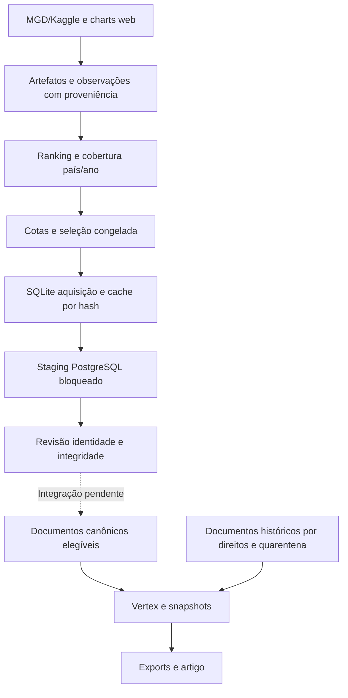

# Auditoria científica e técnica — 6 de novembro de 2026

## A — Avaliação executiva

O Chart Observatory tem arquitetura de pesquisa avançada, acervo analítico histórico e manuscrito. A nova campanha continua em aquisição/remediação e não comprova um corpus mundial de letras corretas e completas. A intervenção principal é ligar identidade da gravação, edição textual e adjudicação a um gate obrigatório de inferência. Não há evidência para atribuir os erros principalmente ao Gemini.

Foram preservadas todas as alterações locais. Esta auditoria não iniciou coleta, não chamou Vertex, não alterou banco, letras ou decisões humanas. Acrescentou um auditor offline e este pacote. A mudança do gate de produção foi especificada, mas não aplicada sem testar todos os caminhos e a migração do legado.

**Limites de inspeção:** inventário de 254.034 arquivos acessíveis, excluindo ambientes e caches de ferramentas; histórico de 55 commits alcançáveis nas referências Git locais; leitura dirigida de código, configurações sem segredos, metodologia, fonte LaTeX, manifestos e relatórios; recontagem integral da seleção e agregados SQLite somente leitura. Inventário não equivale a leitura integral. Não foram inspecionados integralmente todos os blobs, notebooks, observações brutas ou versões históricas. Não houve revisão visual de PDFs/figuras. O PostgreSQL configurado não respondeu à conexão somente leitura (OperationalError); não foi iniciado. Remotos não foram atualizados. Portanto, este pacote não certifica auditoria exaustiva nem integridade total do acervo.

| Medida | Resultado e significado |
|---|---|
| HEAD | `76d97e3b8fb2d1e153201665525bafced4a4cc0a`, com numerosas alterações locais anteriores |
| Escopo operacional | 68 mercados × 9 anos, 2018–2026; corte informado de 15/10/2026; 2026 parcial |
| Seleção recontada | 86.090 vínculos, 28.373 candidatos, 587 células com registros, 67 mercados |
| Status | 83.820 vínculos `CALENDAR_ELIGIBLE`, 2.270 `PROVISIONAL_OBSERVED_PERIODS` |
| Cotas | 9.980 posições/ano; 89.820 desejadas em nove anos; Índia 440/ano, Países Baixos 130/ano |
| Ausências | Andorra (AD) não aparece; 25 das 612 células planejadas não têm vínculos |
| Repetições | 11.055 candidatos repetidos entre países e/ou anos; 5.151 em mais de um país; 61.785 pares candidato–país |
| Staging salvo em 03/11 | 28.373 candidatos, 19.798 hashes textuais distintos, zero prontos para classificação |
| SQLite atual | 33.247 tarefas históricas, 220.308 tentativas; universo diferente da seleção atual |
| Testes desta auditoria | 96 testes focados passaram; sem integração PostgreSQL/Vertex ou validação humana |

As posições respeitam as cotas e correspondem aos candidatos do ranking congelado. Isso valida o contrato de seleção, não sua correspondência com a fonte bruta ou representatividade nacional. O marco de seleção está parcialmente cumprido: há seleção reproduzível, déficits e provisórios. O marco de letras completas e corretas não está demonstrado.

**Operações:** a inspeção CIM não encontrou processos Python/uv/PostgreSQL. O supervisor salvo registra `monitoring`, PID 13416 e prazo encerrado em 02/11; revisão direcionada terminou em `finished_pending_scientific_review` em 03/11. Um PID em JSON não prova processo vivo. SQLite tem uma tarefa `interrupted_pending_review`, sem tarefas `running` na distribuição observada. Não retomar automaticamente com base apenas em status antigo.

## B — Inventário do repositório e do manuscrito

Evidências pesquisáveis: [inventário compactado](inventory.csv.gz), [história Git](git-history.txt), [estado de trabalho anterior ao pacote](git-status.txt), [fontes numeradas](code-evidence.txt), [métricas](measurements.json), [células observadas](country-year-observations.csv). Os caminhos seguintes são relativos à raiz do repositório.

| Material | Caminhos e função |
|---|---|
| Entrada | `README.md`, `CONTEXT.md`, `config/research.yaml`, `config/countries.yaml`; o YAML geral inicia em 2021 e não define sozinho a campanha atual |
| Dependências | `pyproject.toml`, `uv.lock`, `.python-version`: Python ≥3.12, SQLAlchemy, Polars, psycopg, google-genai, Pydantic e Streamlit |
| Banco | `compose.yaml`, `alembic.ini`, `migrations/versions/0001_reference_entities.py` até `0015_gemini_batch_classification.py`; `src/chart_observatory/db/models/` |
| Fontes | `src/chart_observatory/sources/{mgd,kaggle,youtube,promusica,chartmetric,catalog,canonical}.py`; `ingestion/`; modelos `tracks.py`, `charts.py`, `corpus.py`, `provenance.py` |
| Campanha | `scripts/{prepare_quota_import,autonomous_lyrics,supervise_quota_recovery,run_targeted_revision,audit_quota_analysis_scope}.py`; `quota_campaign.py`; `ingestion/{import_quotas,quota_boundary}.py` |
| Aquisição e QA | `lyrics/{quota_acquisition,quota_discovery,genius_client,letras_client,recovery_web,text_quality,identity_collisions,quota_replay_import}.py` |
| Revisão | `lyrics/{quota_staging,staging_review,quota_eligibility,annual_eligibility,review_evidence,identity_quarantine}.py`; `ui/quota_import.py`; `config/lyrics_review_evidence.json`, `lyrics_identity_quarantine.json` |
| Vertex | `lyrics/{classification,classification_service,classification_queue,gemini_pipeline,batch_service,batch_vertex,batch_importer,campaign_budget}.py`; snapshots em `db/models/corpus.py`, batch em `lyrics_batch.py` |
| Seleção atual | `data/derived/annual_revision/reconciled-russia-2018-2026-20261031/`: `combined.jsonl`, `combined-manifest.json`, `selection/`, `sources/{rankings.parquet,source_coverage.csv,country_quotas.csv}` |
| Letras | `data/derived/lyrics/quota-20261030/acquisition.sqlite`, `texts/<sha256>.txt`, caches e replays; este pacote não exporta letras |
| Operação | `data/runtime/{quota-supervisor-20261031,targeted-revision-20261103,postgres-lyric-staging-20261031}/`; `data/runtime/quota-analysis-boundary-20261101.json` |
| Pesquisa | `research/{methodology,limitations,source_inventory,historical_sources_assessment,provider_capabilities,global_market_coverage}.md`; protocolo `lyrical_narratives_research_protocol_2026-09-10.md` |
| Cotas | `research/calculate_import_quotas_20261030.py`; `outputs/annual-import-quotas-20261030/`; política congelada na seleção |
| Artigo atual | `research/article/{article.tex,article.template.tex,compose_article.py,README.md,Musical pornography.pdf}`; README menciona `article.pdf`, nome não encontrado na listagem atual dessa pasta |
| Evidência do artigo | `research/article/{analysis-final,revision-analysis,global-patterns,chart-exposure,social-context}/`, manifests e scripts `analyze_*.py`, `build_analysis.py`, `verify_revision.py` |
| Releases anteriores | `publication/{github,kaggle}/`: artigos TEX/PDF, código, dados, hashes e manifests; não são automaticamente a revisão atual |
| Graphic File | Não identificado nome exato. Candidato funcional: `graphify-out/{GRAPH_REPORT.md,graph.json,manifest.json}`; também há figuras/atlas em `research/article/` e `publication/` |
| Testes | `tests/unit/lyrics/`, `tests/unit/ingestion/` e demais suites; oito módulos foram executados nesta auditoria |

O Graph Report informa 27.729 nós/38.091 arestas e commit `c96c5769`, anterior ao HEAD. Contém relações inferidas e dependências: serve à navegação, não à sustentação de resultados. Atualizar/filtar ambientes antes de reutilizá-lo. `graph.json` foi inventariado, sem validação integral de arestas.

História reconstruída: catálogo multiprovedor/geografia em setembro; Vertex/snapshots em setembro; qualidade e publicação em outubro; campanha de cotas no fim de outubro, com continuidade em alterações locais ainda não commitadas. A branch `backup-main-before-cleanup` está no histórico alcançável; não houve checkout/comparação integral de todas as versões. Registrar versão realmente carregada por execução: mudanças no disco não atualizam processos antigos, como documentado nos runbooks.

Organização proposta, sem mover dados: manter estrutura atual e adicionar futuramente `research/INDEX.md` apontando para protocolos, campanhas, freezes e releases. Cada claim deve ligar `claim_id → tabela/figura → consulta/script → input_sha256 → run_id`. O pacote atual inicia o índice de evidências sem duplicar dados/catálogos.

## C — Arquitetura atual versus alvo



Preservar artefatos/hash, provider separado de plataforma, relações nacionais, catálogo, cache, retomada, locks, backoff, staging, snapshots e UI. Modificar o gate comum de despacho e introduzir promoção adjudicada/versionada. Não há benefício demonstrado para novo banco, microserviços ou tabelas redundantes.


`quota_staging.py:43` em diante exige `NOT classification_ready`, `NOT identity_validated`, `NOT completeness_validated` e direitos `UNVERIFIED`. Isso é proteção deliberada: aprovação requer promoção para catálogo, sem tornar staging mutável. `quota_eligibility.py:10` mantém `not_for_paid_submission`; `annual_eligibility.py:75`, `_validate`, exige documento/hash/gravação exatos, identidade/integridade verificadas e evidência.

Porém `classification_service.py:208` e `classification_queue.py:107` selecionam documentos históricos por direitos, quarentena, reports e assinatura, sem exigir positivamente aquela adjudicação. O caminho direto sem `only_unclassified` também não usa o mesmo filtro de reports do iterador compartilhado. Há risco de caminhos divergentes, não prova de envio do staging. Implementar predicado único obrigatório para online/batch/force/estimate. Force invalida cache, nunca QA.

Usar `canonical_tracks` como gravação, preservando `track_master` e IDs nativos conforme o catálogo. Obra/ISWC não substitui gravação/ISRC. Covers, versões limpas, traduções, ao vivo e remixes exigem identidades próprias. ISRC é evidência forte, com conflitos revisáveis. Hash igual deduplica bytes, mas não prova identidade musical. Compartilhar inferência entre gravações somente com equivalência textual adjudicada e tarefa estritamente textual; manter todos os vínculos nacionais.

Assinatura alvo: `lyrics_hash + recording/text-edition scope + resolved_model_version + prompt_hash + schema_hash + preprocessing_version + generation_config_hash + protocol_version`. Hoje gravação/hash/modelo/taxonomia/prompt já existem (`classification_service.py:467`, `classification_queue.py:107`); falta demonstrar invalidação por configuração/preprocessamento/revisão do modelo. Idioma contextual usado no prompt também entra na assinatura. `error` hoje conta como tratado para evitar loops; não deve virar anotação válida reutilizável. Reprocessamento exige plano explícito.

## D — Metodologia científica

### Cobertura, fontes e tempo

O objeto observado é repertório de charts de plataformas em mercados, não amostra probabilística dos residentes ou de toda música mundial. Quotas maiores não corrigem viés de adoção da plataforma. Separar universo geográfico ISO 3166 com exceções documentadas, mercados observados e células comparáveis. Registrar `NO_SOURCE`, `ACCESS_PENDING`, `NO_COMPLETE_CALENDAR`, `INSUFFICIENT_DEPTH`, `IDENTITY_PENDING`, `LYRIC_PENDING`; ausência não é zero consumo. O esquema já dispõe de ISO3/M49 em `db/models/corpus.py:31`. [UN M49](https://unstats.un.org/unsd/methodology/m49/overview/) fornece referência de regiões; versionar exceções, códigos históricos, territórios e GLOBAL/sintéticos.

Streams somados enquanto a faixa está na parada são medida censurada pela profundidade, não streams totais nacionais. Rank não é contagem, Viral 50 não equivale a Top 200, vídeo popular não equivale a YouTube Music Songs. Não somar espelhos MGD/Kaggle ou streams/views. Preferir análise por fonte/família. Agregação por percentis/rank pode ser índice com pesos explícitos, nunca contagem real.

`import_quotas.py:79` prefere Spotify entre calendários completos, exige posições contíguas e métricas inteiras não crescentes. Documentar essa precedência. Auditar calendário, profundidade por dia, duplicatas, anos bissextos, métricas revisadas e semanas cruzando ano. Completar calendário não prova conteúdo correto. Preservar datas de publicação e captura. Analisar 2026 parcial separadamente e comparar janelas iguais; escolher painel por regra de cobertura anterior aos efeitos.

| Fonte | Uso e limitação |
|---|---|
| MGD/Kaggle | Histórico Spotify local, hashes e precedência; espelhos não são fontes independentes |
| Spotify Charts/Web API | Chart é ranking; API de catálogo/metadados não recompõe histórico anual automaticamente |
| YouTube Music web | Songs/views conforme chart preservado; API mostPopular é vídeo atual, sem equivalência histórica |
| Pro-Música Brasil | Validação nacional e agregado com metodologia própria, sem extrapolação mundial |
| Chartmetric/Soundcharts | Histórico potencial sob acesso/licença; verificar cobertura por data e cotação antes de ampliar |
| Luminate/IFPI/fontes nacionais | Consumo e contexto quando disponíveis/licenciados; não presumir série pública por faixa |
| Apple/Deezer/Shazam | Rankings/descoberta segundo fonte, sem chamar rank de plays; snapshot não preenche ano histórico |

`research/historical_sources_assessment.md` é pesquisa local detalhada, não tabela de preços atual certificada aqui. `targeted-revision-20261103/ranking-source-decisions.json` mantém Apple IN/2018 como referência não anual, rejeita totais all-time IL/2023–2024 como anuais e não inicia bulk Circle. Essas decisões foram preservadas. [Schedl et al.](https://arxiv.org/abs/2009.09935) apoia considerar heterogeneidade cultural entre países; não valida representatividade do acervo deste projeto.

### Quotas explícitas

Fórmula existente em `research/calculate_import_quotas_20261030.py`:

`q_c = min(500, 100 + 10 floor[k sqrt(P_c/10^6)(1 + 0,5 D_c)/10])`.

P é população 2024; D é fracionalização étnica histórica, não diversidade musical atual. Coeficiente calibrado para união observada e participações. Tabela congelada: IN=440 e NL=130, razão 3,38. Preservar como baseline operacional versionado.

Piso protege mercados pequenos; raiz/teto limitam concentração. Contudo 100/500/0,5 são decisões, não ótimos estatísticos; D antigo não representa diversidade linguística/musical contemporânea e calibrar pelo acervo depende de disponibilidade. Custo presumido US$0,001 não garante precisão.

Alternativa experimental pré-registrada:

`w_c = (P_c/P_ref)^alpha (M_c/M_ref)^beta exp(gamma H_c)`;
`q_c(lambda) = min(U_c, L + s floor(lambda w_c/s))`;
`U_c = min(q_max, posições_elegíveis_da_fonte)`.

M é consumo/mercado comparável verificado; H diversidade musical/linguística documentada. Se M/H faltarem, não imputar zero: usar baseline alpha=0,5, beta=gamma=0 e cenários completos separados. Piso é meta, não observação inventada. Calibrar lambda monotonicamente sob `|união selecionada| ≤ B` e custo de tarefas únicas elegíveis + reserva ≤ teto. Se pisos não couberem, declarar desenho inviável e revisar globalmente. Desempate determinístico e manifesto de fontes/parâmetros obrigatórios.

Comparar cotas iguais (comparabilidade), proporcional à população (concentração), raiz (compromisso), log (compressão) e híbrida (dependência de covariáveis). Neyman só faz sentido com variância/custos piloto adequados e não transforma Top N em sorteio aleatório. [Beaumont, Survey Methodology](https://www150.statcan.gc.ca/n1/pub/12-001-x/2020001/article/00001-eng.htm) explica a dependência de pressupostos em inferência de fontes não probabilísticas.

Sensibilidade: alpha={0;0,25;0,5;0,75;1}, D desligado/atual, pisos 50/100, tetos 300/500 e budgets 20k/30k. Reportar união, concentração nos cinco maiores, déficits, Jaccard do repertório, línguas, prevalência e mudança de posições nacionais. Comparar Top 100 comum e janela/fonte comuns. Esses efeitos ainda não foram medidos. Não substituir músicas por inferiores quando falta letra.

Separar média entre mercados (peso igual), prevalência no repertório selecionado (gravações) e exposição em chart (streams/dias observados). Peso populacional exige estimando justificável; inverso de quota não é probabilidade de inclusão. Quotas maiores mudam a profundidade de popularidade.

## E — Qualidade e investigação causal

`targeted-revision-20261103/text-audit-summary.json` auditou 22.250 registros do run `ee52f...`, anterior ao staging final `dc8f...`: 2.529 requeriam reparo (11,37% dos examinados), 19.721 passaram checks de fonte sem provar gravação/completude, 112 grupos de colisão textual. Flags sobrepostas: 1.893 sem evidência integral de intérpretes, 1.798 escopo da página não verificado, 1.479 sem identidade da fonte, 1.186 créditos não verificados, 164 divergências de metadata, 35 intérprete/versão, 24 curtos, 11 muito curtos, duas durações discrepantes. São sinais, não taxas de letras erradas nem medição do snapshot seguinte.

**Proporção genuinamente correta/completa: não estimada.** Zero verificados indica ausência de prova exigida, não que todos estejam errados. Os 19.798 hashes não são transcrições certificadas. Mesmo hash não prova identidade; hashes distintos podem ser apenas whitespace.

Riscos documentados: provider declara incompletude; identidade da entidade principal/containers Genius; metadata nativa corrigida depois da busca; créditos confundindo produtores/intérpretes; edições LRCLIB divergentes; 429/503; escapes JavaScript e preservação do último verso. Há guardas e regressões para vários casos. Não há causa única demonstrada dos cortes iniciais/finais.

`text_quality.py:108` sinaliza começo no segundo verso, avisos de trecho, resíduos e comprimento: triagem, não certificação. `html_lyric_text` preserva br/parágrafos; `outer_lyric_containers` evita contagem dupla de nós aninhados. `db/models/corpus.py:199` e staging usam SQL Text, sem pequeno limite varchar declarado; isso enfraquece truncamento por campo nesses pontos, sem excluir transporte/export. Limites de hits/links nos clientes limitam buscas, não caracteres da letra. Não remover refrões como duplicatas; texto curto pode ser completo.

Diagnóstico por caso: resposta bruta/hash → encoding/Content-Length/paginação/estado provider → replay do extrator congelado → comparação início/meio/fim antes/depois de cada transformação → bytes no banco/export → áudio ou transcrição autorizada da gravação exata → adjudicação. Não reconstruir versos com IA. Duas fontes espelhadas não são validação independente. Preservar original e derivado NFC versionado; transliteração só para busca, não texto analítico; língua por letra, não país.

Estados alvo adaptados à estrutura existente: acquired_unverified, identity_conflict, suspected_partial, source_declared_partial, validated_complete, instrumental_verified, unavailable, pending_adjudication. Cada decisão vincula candidate/recording/document/hash, avaliador, método, URL/hash de evidência e timestamp. Aprovar metadata não aprova transcrição. Texto corrigido cria nova versão e invalida aprovações/annotations dependentes, sem apagar histórico.

Taxonomia causal: RANK_SOURCE; IDENTITY_TRACK/VERSION; LYRICS_PARTIAL_START/MIDDLE/END; LYRICS_WRONG; PARSING_ENCODING; DEDUP_FALSE_MERGE/SPLIT; PROMPT; MODEL; OUTPUT_SCHEMA; DB_MAPPING; RUBRIC_AMBIGUITY; UNKNOWN. Permitir múltiplas causas e causa primária adjudicada. `review_evidence.py` já preserva relatos como pending_adjudication e bloqueia por hash; justificação não vira verdade automática.

Revisão detalhada futura continua pendente. Ao chegar, exigir IDs candidato/gravação/documento, hash efetivamente avaliado, snapshot/modelo/prompt/schema/configuração, output bruto, campo/rótulo contestado, referência humana/justificativa, evidência autorizada, idioma, revisor e exposição à resposta IA. Ausências entram UNKNOWN, nunca casamento só por título. Relatos anteriores já existentes não substituem esse relatório futuro.

Experimento 2×2: input original/corrigido verificado × prompt atual/candidato, modelo/schema/configuração fixos, referência humana independente e controles de letras íntegras. Repetir subconjunto para medir variabilidade. Comparar entrada estima efeito upstream no conjunto; comparar prompt estima melhoria condicional. Binário: McNemar e IC pareado; ordinal: erro absoluto/discordância ponderada e bootstrap por gravação. Distinguir troca de identidade de simples correção textual.

## F — Implementação por fases

São propostas, não trabalho concluído. P0–P5 precedem produção paga; P6 precede conclusões fortes; P7 depende de benchmark. Commits pequenos, rollback por manifesto e preservação de dados válidos.

| Fase/prioridade/dependência | Estado, arquivos e mudança | Aceitação e testes | Benefício, custo e risco |
|---|---|---|---|
| 0/P0/nenhuma | Auditor adicionado; `scripts/audit_research_snapshot.py`, este pacote. Congelar baseline; estender inspeção a partições brutas/versões não revisadas | Reproduzir hashes/totais; índice de claims e limites de inspeção; inventário legível | Traceabilidade, offline; I/O alto mitigado por manifests incrementais |
| 1/P0/0 | 612 células alvo/587 observadas; `ingestion/import_quotas.py`, `quota_boundary.py`, fontes/config. Fixar universo/janela e auditar profundidade | Todas células com motivo; zero excessos/duplicatas; ranking independente por país/ano/empates; métricas separadas | Validade comparativa; coleta extra só com escopo/custo; calendário não basta |
| 2/P0/1 | Catálogo/IDs já existem; `tracks/`, `corpus/`, `identity_collisions.py`. Resolver gravação/edição e conflitos | Gold set de covers/remixes/homônimos; medir precision/recall. Meta proposta: limite inferior IC de precisão ≥99%, a registrar antes | Menos downloads/erros; custo humano; não fundir para caber no budget |
| 3/P0/1–2 | `text_quality.py`, clientes, `quota_acquisition.py`. Resposta/hash/extrator e checks de integridade | Fixtures corte inicial/meio/fim, longas, curtas completas, RTL/CJK, Unicode e repetições; HTTP 200/comprimento não aprovam | Input confiável; heurística não garante completude; revisão estratificada |
| 4/P0/3 | `quota_replay_import.py`, `staging_review.py`, `review_evidence.py`. Adjudicar e promover transacionalmente | Idempotência, histórico preservado, hash novo invalida approval/cache, rollback; provisórios continuam separados | Reuso válido; revisão/recuperação limitada; priorização não exclui línguas difíceis |
| 5/P0/2–4 | `classification_queue.py`, `classification_service.py`, `batch_service.py`, `quota_eligibility.py`, repository. Gate positivo e assinatura completa | Online/batch/force/estimate recusam sem evidência/hash atual; schema/semântica/finish reason; reuso compatível; testes sem chamadas reais | Impede contaminação; legado pode bloquear: aprovação documentada, sem liberação geral |
| 6/P1/3–5 | `research/article/revision-analysis/` e avaliação. Confirmar línguas, referência cega, experimento 2×2 e sensibilidades | Dois avaliadores qualificados + adjudicação; seeds/IC/denominadores; desenvolvimento separado do teste | Evidência científica; custo humano dominante; evitar otimizar prompt no teste |
| 7/P2/5–6 | `batch_*`, `campaign_budget.py`, telemetry. Benchmark de cache/modelo/batch/seções | Mesmo gold set, custo total/sucesso e limites de não inferioridade pré-definidos | Economia comprovada; não retirar versos/trocar modelo sem teste |
| 8/P1/6 | `research/article/*.tex`, scripts/manifests, `publication/`. Claim registry e release coerente | Cada número reproduzível; métricas humanas medidas ou pendentes; renderizar PDF/figuras | Publicabilidade; editar templates geradores; não misturar freezes |
| 9/P1/1–8 | Suites, migrations, copia restaurada PostgreSQL; E2E de amostra adjudicada | Gate em todos despachos; crash/resume sem duplicação; rollback; ledger; relatório integral | Confiança operacional; não testar migração no banco único; piloto com teto |

As metas de acurácia são propostas, não resultados. Não impor um F1 a todas as variáveis. O auditor foi implementado; os demais passos não foram aplicados à produção nesta entrega.

Verificação executada:

```powershell
.\.venv\Scripts\python.exe scripts/audit_research_snapshot.py
.\.venv\Scripts\python.exe -m pytest tests/unit/lyrics/test_acquisition_text_quality.py tests/unit/lyrics/test_genius_identity_guard.py tests/unit/lyrics/test_quota_acquisition.py tests/unit/lyrics/test_quota_discovery.py tests/unit/lyrics/test_staging_review.py tests/unit/ingestion/test_quota_boundary.py tests/unit/lyrics/test_identity_collisions.py tests/unit/lyrics/test_quota_campaign.py -q
```

Resultado: **96 passed in 6.62s**. Auditor lê SQLite/input sem mutação e escreve seu próprio pacote. O script preexistente `audit_quota_analysis_scope.py` não foi executado porque contém `COMMENT ON TABLE`, apesar do nome de auditoria.

## G — Eficiência e custos

Medido: 86.090 vínculos → 28.373 candidatos, razão 3,03; 57.717 tarefas evitáveis (**67,04%**) versus trabalho por vínculo país/ano. Apenas entre países: 61.785 pares → 28.373 candidatos, 33.412 tarefas (**54,08%**) versus uma tarefa por país, sem anos. É oportunidade aritmética, não economia observada de chamadas: o sistema já reutiliza candidatos e nem todos são elegíveis.

Não calcular duplicação de letras como 28.373−19.798: há candidatos sem texto. Os 27.094 blobs históricos também não são o corpus atual. Medir candidatos com texto, bytes/tokens e multiplicidade de edições válidas no snapshot exato antes de estimar armazenamento/inferência.

`C = Σ_tarefas_novas[(T_in p_in + T_out p_out + T_think p_think)/10^6] + storage + requests + revisão`.

Se raciocínio já integra output na tabela do modelo, não somar duas vezes. Registrar modelo resolvido, região, online/batch e validade dos preços; conferir [pricing oficial](https://cloud.google.com/vertex-ai/generative-ai/pricing), atualmente redirecionado para Model Garden. Exemplos do README não são cotação do projeto. Ledger privado/fatura não foram verificados.

Cenário puramente aritmético US$0,001/candidato: US$86,09 por vínculo versus US$28,373 por candidato; diferença US$57,717. Não é fatura prevista: faltam tokens reais, retries, output/raciocínio, GCS e revisão. Documentos atuais informam teto US$150; `config/revision_campaign_budget.json` ainda descreve campanha antiga US$180 com inferência desautorizada. Configuração única por campanha e ledger impedem mistura.

Ordem: cache válido → replay offline → identidade antes de inferência → tarefa única por edição/assinatura → benchmark batch/modelo. [Batch oficial](https://docs.cloud.google.com/gemini-enterprise-agent-platform/models/capabilities/batch-inference) documenta a modalidade; não presumir desconto/disponibilidade genéricos. Prefix caching não equivale a cache de resultado. Reduzir input exige experimento de validade por variável.

Gargalos documentados: 429/503/cooldowns, conflitos de identidade/edição, QA pendente, muitos arquivos de cache. Preferir manifests por partição e índices; não apagar histórico/cache para otimizar sem retenção/proveniência. Tokens, tempo e custo por sucesso devem ser medidos, não inferidos da quantidade de arquivos.

## H — Plano de publicação e validação

Freeze do artigo em 11/10/2026: manifesto registra 159.111 documentos, 154.964 gravações gerais selecionadas, 153.501 geográficas, 461.447 pares anotados e 68 mercados. Assinatura: gemini-3.8-flash, taxonomia v1, prompt v2; código atual usa prompt v3 (`classification.py:12`). Preservar ambos; a campanha 2018–2026 não substitui automaticamente esse corpus.

O TEX atual reconhece verificação por especialistas reportada sem tamanho/rótulos/erros; não fornece acurácia medida. Reconhece pacote cego com 3.381 gravações provisórias, avaliações não preenchidas e língua não confirmada. Isso é adequado. “Todos classificados” vale para o corpus final selecionado: o universo do manifesto contém 1.707 errors, 1.589 insufficient_text e outros status. Publicar o funil evita confundir sucesso de classificação com completude do inventário.

Experimentos obrigatórios: identidade/completude multilíngue; desempenho temático por língua/fonte/score; input original/corrigido; sensibilidade de quota/Top100/fonte/janela; estabilidade de efeitos/clusters por reamostragem; ausência de letras e indicadores sociais. Letras não medem diretamente valores nacionais ou comportamento individual. Associação ecológica não é causalidade; repertório compartilhado induz dependência entre mercados.

Referência: aproveitar amostra existente, confirmar língua e frame antes do sorteio final. Estratificar país/região, língua/script, fonte, posição, ano, comprimento e flags sem exigir produto cartesiano completo. Sobreamostrar raros e ponderar estimativas globais segundo desenho; separar diagnóstico de estimação. Dois avaliadores independentes competentes na língua e adjudicador; ocultar output IA e avaliação alheia. Identidade pode usar metadata/áudio, etapa temática permanece cega à previsão.

Planejamento ilustrativo de proporção: n≈385 para ±5 pontos/95% sob amostra aleatória simples conservadora (1,96²×0,25/0,05²). Não garante precisão por país/idioma nem em clusters; ajustar por desenho/perdas. Zero falhas não significa taxa zero; regra aproximada 3/n é só referência de planejamento.

Métricas: identidade/completude com proporções e IC Wilson/exato conforme desenho; dedup precision/recall em pares adjudicados; intensidade ordinal com MAE, confusão e alfa ordinal/kappa ponderado; categorias nominais com F1 por classe/macro; presença binária ≥2 somente com limiar declarado; resumos por rubric humana. Confiança IA requer calibração contra evento definido, Brier/ECE quando apropriado. Bootstrap por gravação preserva reaparições; não tratar 86.090 vínculos como letras independentes.

Tabelas: funil por célula; cobertura/quotas; QA por língua/fonte; erros por estágio; desempenho por variável; contraste original/corrigido; custo por sucesso; claims. Figuras: cobertura, pipeline, concentração/reuso, confusão, efeitos com IC e sensibilidades. Registrar hipóteses e multiplicidade antes de escolher resultados favoráveis.

[Datasheets for Datasets, Gebru et al.](https://arxiv.org/abs/1803.09010) fundamenta documentação de composição/coleta/usos/limites. [Enhancing Human Annotation](https://www.microsoft.com/en-us/research/wp-content/uploads/2024/01/chiir24-34.pdf) exemplifica avaliação ordinal; não fornece benchmark musical. [Structured output oficial](https://docs.cloud.google.com/gemini-enterprise-agent-platform/models/capabilities/control-generated-output) fundamenta schema, não correção semântica. O projeto já configura JSON schema em `gemini_pipeline.py:315`; preservar e testar, sem reconstruir como recurso inexistente.

**Direitos:** registrar como relato do responsável autorização atribuída ao Ministry of Communicative Relations e ao Ministry of Economic Development, com escopo mundial informado. Não foi verificada documentação específica desses instrumentos nesta auditoria; existem registros prévios de ativação no projeto. Vincular instrumento/emissor/jurisdição/titular/fontes/territórios/prazo/nuvem/redistribuição quando disponível. O relato não impede análise metodológica e não comprova sozinho exceção a contratos de fornecedores. A [política Spotify](https://developer.spotify.com/policy) contém restrições sobre conteúdo em IA; documentar acordo aplicável antes de ampliar acesso. Não houve nova coleta/contorno de bloqueios. Publicar hashes, metadata licenciável e agregados; manter letras/chaves privadas dos avaliadores fora do release.

## I — Ações imediatas

| Ordem | Ação | Definição de pronto |
|---|---|---|
| Corrigir agora/P0 | Gate comum online/batch/force/estimate | Documento com direitos, mas sem adjudicação/hash atual, não alcança provider em nenhum caminho |
| Corrigir agora/P0 | Manifesto e budget únicos | Anos/corte/quotas/hash/modelo/schema/prompt/teto US$150/ledger fixados; campanha antiga US$180 não governa a nova |
| Corrigir agora/P0 | Conciliar 2.529 suspeitos/112 grupos com staging final | Lista por run/document/hash; reparos preservam antes/depois; pendentes bloqueados, sem dupla contagem |
| Completar/P0 | Promoção adjudicada | Transação cria documentos/evidências sem alterar staging; letra ausente não avança fronteira do ranking |
| Completar/P1 | Cobertura e referência humana | Todos territórios-alvo com status; 612 células conciliadas; línguas confirmadas e sorteio reproduzível |
| Validar/P1 | Experimento input/prompt e robustez | Referência independente, métricas/IC apropriados e comparação pareada; mudança de modelo exige ganho demonstrado |
| Validar/P2 | Benchmark reuso/batch/cotas | Tokens/custo por sucesso incluindo falhas/revisão; sensibilidade publicada |
| Publicar/P1 | Claims e release | Cada número liga script/input; avaliação medida ou marcada pendente; PDF/figuras revisados visualmente |

### Respostas às 18 questões críticas

1. **Coleta mundial completa?** Não demonstrada: 68 mercados-alvo, 67 com vínculos, lacunas e provisórios; não todos os países.
2. **Representatividade?** Repertório de charts observados; não consumo nacional total ou população mundial.
3. **Quotas adequadas?** Explícitas/aplicadas, mas decisões piso/teto/diversidade requerem sensibilidade e não garantem precisão.
4. **Índia versus Países Baixos?** 440/130 na política atual; alternativas em D sem alteração silenciosa.
5. **Duplicatas?** 11.055 candidatos repetem em países/anos; 5.151 entre países. Equivalência de gravação/letra requer adjudicação.
6. **Economia?** 57.717 tarefas por vínculo evitáveis, 67,04%; não igualar a economia efetiva Vertex.
7. **Letras completas?** Proporção não estimada por referência independente; zero liberações no staging salvo.
8. **Cortes iniciais/finais?** Mecanismos plausíveis e correções documentadas; causa por caso exige resposta bruta e rastreio.
9. **Matching pode explicar erros?** Sim como hipótese, com sinais de risco; efeito causal ainda não medido.
10. **Separar input/modelo?** Comparação pareada original/corrigido e experimento 2×2 com referência independente.
11. **Reuso seguro?** Artefatos/cache íntegros; letras e outputs somente com identidade/hash/assinatura compatíveis e validação.
12. **Corrigir/quarentenar?** Conflitos/defeitos/relatos pendentes por hash; preservar histórico e não condenar todos os textos.
13. **Maior ganho científico?** Gold set multilíngue, QA positivo, cobertura transparente e estimandos explícitos.
14. **Maior ganho arquitetural?** Gate compartilhado e processamento global por edição/assinatura, mantendo relações nacionais.
15. **Manuscrito consistente?** Reconhece limites do freeze antigo; não representa nova campanha; falta avaliação independente e conferência integral de resultados/figuras.
16. **Antes do lote seguinte?** Gate, protocolo/budget únicos, adjudicação/piloto; provisórios e textos não verificados bloqueados.
17. **O que falta do relatório futuro?** IDs/hashes/input/output/configuração exatos, categoria, evidência/rótulo humano, idioma/revisor/exposição IA.
18. **Caminho eficiente?** Preservar arquitetura, concluir P0–P5, avaliar P6, otimizar por benchmark e atualizar artigo/release.
