# Remediação executada e pacote para revisão independente — 06/11/2026

## Escopo e avaliação

Esta rodada executou correções e processamento local, preservando o freeze científico de outubro. O sistema está disponível para revisão técnica e avaliação humana das pendências; **não está cientificamente validado nem liberado para nova campanha paga**. Não houve chamadas Vertex, geração de letras, scraping novo ou gasto de inferência. As consultas públicas realizadas foram de documentação técnica.

O [relatório anterior](../audit/2026-11-06/REPORT.md) é uma fotografia histórica. Seus trechos sobre PostgreSQL indisponível e gate ainda não implementado foram superados nesta rodada, sem reescrever a evidência original. O [report.md atual](../../report.md) e os artefatos desta execução registram o novo estado.

## Alterações implementadas

- `lyrics/classification_gate.py`: predicado positivo compartilhado por documento/gravação/fonte/hash. Exige adjudicação aprovada, identidade e integridade explícitas, evidência HTTPS/hash, método admitido, responsável e timestamps com timezone. Rejeita direitos insuficientes, fonte suspensa, quarentena e relatos pendentes. Aprovação de metadados não é aprovação textual.
- `classification_queue.py` e `classification_service.py`: online, only-unclassified, force, estimate e contagem da fila usam o gate; revalidam documento atual antes da tokenização/geração. Force e include_identity_holds não dispensam QA. Estimate não gera ou grava snapshots.
- `batch_repository.py` e `batch_service.py`: gate em reserva/retry/export, tokenização, upload e envio; conferência da assinatura do request congelado, configuração, idioma, gravação/hash e contagem de itens. Aprovação revogada bloqueia batch preparado.
- `batch_importer.py`: gate antes de importar nova anotação. Sem elegibilidade, interrompe com `BatchIntegrityError` sem criar classificação; outputs privados do provider e snapshots históricos permanecem preservados. Custos/outputs de jobs antigos não devem ser confundidos com novas anotações válidas. Finalização de erro sem output não é aprovação científica.
- `adjudication.py`: registro transacional em metadados existentes, com lock de linha PostgreSQL, compare-and-set por hash/decisão anterior, histórico de decisões e rollback. Aprovar requer evidência explícita; rejeitar/quarentenar/manual_review remove a aprovação corrente, preservando a anterior no histórico. Não inventa decisões nem modifica versos. Chamador controla commit.
- `gemini_pipeline.py` e `lyrics_backfill.py`: caminhos legados sem documento adjudicado não geram anotações; aquisição usa skip-gemini. Adapter de baixo nível fica restrito aos serviços controlados/testes.
- `genius_client.py` e `letras_client.py`: textos curtos e de uma linha não são descartados pelo extrator. Removidas substituições genéricas que podiam apagar versos como “Enviada por…” em qualquer posição. Rodapé conhecido continua sendo derivado explícito. Isso corrige defeitos demonstrados por fixtures; não atribui automaticamente esses mecanismos a todos os erros históricos.
- `corpus_quality.py` e `audit_current_lyric_corpus.py`: screening conservador de 100% do staging, em PostgreSQL repeatable-read/read-only, checkpoint próprio, hashes do texto e comparação SQLite/staging. Nenhuma heurística promove texto a completo.
- `replay_cached_quota_lyrics.py`: saída isolada, desfecho not_found contado explicitamente e checkpoint de negativos para um cache congelado. A rede é impedida por MockTransport. Novos caches exigem nova saída de replay.
- `revision_protocol.py`: perfis completos de execução com versão resolvida de modelo, hashes de prompt/schema, configuração, preprocessing/protocolo; contexto de língua passa a invalidar a assinatura de preparação. Mantém reserva exclusiva e estado uncertain. A integração completa dessa assinatura com o legado de snapshots online ainda requer trabalho antes de produção paga; não presumir que apenas modelo/prompt nominal bastem.
- `analyze_quota_sensitivity.py`: dez cenários locais sobre o mesmo frame de país/ano/plataforma e ranking congelado; não altera a seleção usada na pesquisa.

Nenhuma nova coluna analítica, taxonomia, quota oficial ou migração de produção foi introduzida. O schema de aprovação e as limitações de autenticação do avaliador estão no [gate](classification-eligibility-gate.md). Este código valida a declaração e o vínculo; não autentica uma pessoa ou direitos por consulta remota.

## Evidências e resultados executados

Raiz privada dos artefatos: `data/runtime/remediation-20261106/`. Não publicar backups, dumps, respostas brutas ou propostas textuais.

| Processo | Evidência |
|---|---|
| Preservação de código | `working-tree-before-remediation.zip` e `backup-manifest.json`: 72 arquivos preservados no início desta rodada ampliada |
| Backup de aquisição | `acquisition-before-repair.sqlite` e `acquisition-backup.json`: backup API SQLite, 924.643.328 bytes, SHA256 verificado antes de aplicar reparos |
| Baseline atual | `full/summary.json`, `full/audit-checkpoint.sqlite`, `full/country-year-quality.csv`: 28.373 candidatos auditados |
| Replay piloto | `replay-pilot/status.json`: 100 processados, uma proposta, 99 não encontrados, zero erros/rede |
| Replay completo | `replay-full/status.json`: 8.613 processados, cinco propostas, 8.608 não encontrados, zero erros/rede |
| Ensaio de reparo | `repair-simulation.json`: cópia SQLite isolada, cinco importações, integridade ok |
| Aplicação | `repair-applied.json`: quatro lacunas preenchidas e um reparo, histórico preservado; 33.247 tarefas mantidas, demais candidatas inalteradas; segunda importação fez zero mudanças |
| Staging posterior | `staging/status.json`: novo snapshot imutável; os registros antigos continuam presentes. Conferir o run_id no relatório atual |
| Reauditoria posterior | `after/summary.json`: medidas pós-reparo, sem certificar completude |
| PostgreSQL clonado | `postgres-clone/{report.json,pytest.log,junit.xml}`: dump lógico read-only, restauração integral em cluster separado, testes e comparação de fingerprints |
| Adjudicação PostgreSQL | `tmp/remediation-postgres-tests.log`: três testes novos de commit/rollback/concorrência e teste do lock da fila na base isolada; outros 40 foram então pulados por exigirem o harness de clone e passaram na execução desse harness |
| Suites offline | `tmp/remediation-final-tests.log`, `tmp/remediation-lint.log`: resultados finais, sem testes live |
| Quotas | `quota-sensitivity/{summary.json,scenarios.csv}`: baseline reproduzido exatamente, dez cenários |
| Manuscrito | `manuscript-validation.json`: 50/50 hashes inputs/outputs correspondentes; 154.995 linhas selecionadas conforme manifesto; PDF A4 com 11 páginas renderizadas |

Baseline de qualidade, anterior aos cinco reparos: 22.289 candidatos com texto e 6.084 sem texto local. Screening: 19.760 acquired_unverified, 1.912 pending_adjudication, 588 identity_conflict, 29 suspected_partial. Esses estados não são diagnósticos humanos. Os 2.529 suspeitos anteriores foram todos conciliados nesse snapshot; 112 grupos de colisão textual permanecem para revisão. Flags são sobrepostas, não somar como pessoas/músicas distintas. Letras completas independentemente verificadas nesta campanha: **zero comprovadas**.

Os hashes das 22.289 cadeias com texto conferiram entre SQLite, blob local e staging. Não foi detectado corte introduzido nessa transferência. Isso não prova correspondência com áudio ou resposta original do provider. A documentação e as fixtures demonstram riscos de extração; o diagnóstico causal de cada transcrição ainda depende de evidência de referência.

Depois dos reparos, 22.293 cadeias conferiram e 6.080 permaneceram sem texto.
O novo run é `bc7afdd8e7b3382d607584449a14117abd8de80b5b0f58a5b734d458ad04cdff`.
Screening posterior: 19.765 acquired_unverified, 1.911 pending_adjudication,
588 identity_conflict, 29 suspected_partial, 6.080 unavailable. A redução de
19.798 para 19.797 hashes distintos não é perda de candidatos: os quatro
preenchimentos reutilizam blobs existentes e o reparo deixa um hash antigo
fora do snapshot corrente, preservado no histórico. O diff entre checkpoints
confirma exatamente cinco alterações e é mais eficiente que juntar duas
seleções extensas no PostgreSQL.

Uma consulta diagnóstica redundante de diff SQL foi cancelada após execução
lenta; a comparação equivalente dos checkpoints terminou e confirmou quatro
preenchimentos e um reparo. Não houve rollback de dados nem interrupção de coleta.
O primeiro ensaio do teste de corrupção também expôs metadata sem título/autor;
o screening foi corrigido para registrar ausência, e o teste passou. Uma tentativa
de executar um arquivo de teste inexistente foi corrigida para os módulos reais.
Esses ensaios não são apresentados como verificações bem-sucedidas.

Quotas: cenário atual raiz+diversidade reproduziu 86.090 vínculos e 28.373 candidatos, IN/NL=440/130. Raiz sem diversidade: 86.060 vínculos, 28.442 candidatos, 430/130, Jaccard de repertório 0,97199. Igualdade quantizada: 140/140, 25.095 candidatos, 82.180 vínculos, Jaccard 0,80069; sobra 460 posições no budget por exigir uma quota igual em passos de dez. São cenários operacionais, não efeitos temáticos, precisão ou representatividade demonstrada.

## Arquitetura e estados para o revisor Vertex

```mermaid
flowchart LR
  A[Fontes preservadas e ranking congelado] --> B[Seleção por país ano e quota]
  B --> C[Aquisição e replay offline]
  C --> D[Staging imutável e screening]
  D --> E[Revisão humana da gravação e transcrição]
  E --> F[Adjudicação por documento e hash]
  F --> G[Gate único obrigatório]
  G --> H[Estimate sem geração ou inferência controlada]
  H --> I[Import com revalidação e snapshot]
  I --> J[Freeze analítico separado e artigo]
```



Estados de aquisição e screening permanecem distintos de aprovação. Uma proposta pode ter metadata exata e ainda ser acquired_unverified. validated_complete e instrumental_verified exigem evidência real, não foram atribuídos automaticamente. Rejeição preserva histórico. Alterar bytes, gravação, documento ou fonte torna aprovação incompatível; alterar idioma/request/configuração invalida batch preparado. Direitos/source holds continuam obrigatórios. A nova API de adjudicação não substitui autenticação/autorização do operador e não constitui UI de promoção do staging.

O catálogo mantém gravação e relações nacionais; SHA256 compartilha armazenamento, não identidade musical. O revisor deve avaliar especialmente: fronteiras online/batch/import; controle de acesso para gravação de adjudicações; concorrência de revogação versus despacho; completude da assinatura histórica; tratamento de custos de outputs retidos; isolamento dos freezes. Não enviar letras, credenciais ou dumps para uma revisão técnica externa sem necessidade e autorização específica.

## Reprodução sem inferência

```powershell
.\.venv\Scripts\python.exe -m pytest tests/unit tests/contract -q --basetemp tmp/pytest-review
.\.venv\Scripts\python.exe scripts/audit_current_lyric_corpus.py --output data/runtime/review-corpus
.\.venv\Scripts\python.exe scripts/analyze_quota_sensitivity.py
.\.venv\Scripts\python.exe scripts/validate_postgres_gate.py
```

O último comando cria e retém cópia privada do banco, exige PostgreSQL local e espaço livre, inicia somente o cluster isolado e o encerra ao concluir. Não é teste live do Vertex. `audit_current_lyric_corpus.py` lê o staging atual e escreve apenas saída própria; a comparação histórica usa o conjunto suspeito preservado em 03/11. `analyze_quota_sensitivity.py` escreve apenas seu diretório de cenários, nunca a seleção. Para repetir replay com novo cache, especificar nova saída e estado; reaproveitar output significa manter o mesmo cache congelado.

## Rollback e preservação

Código: comparar hashes com o backup e recuperar somente arquivos específicos necessários, preservando alterações posteriores; não executar reset global. Banco: não houve UPDATE/DELETE de letras históricas ou snapshots classificados. O staging posterior é append-only: para análise anterior, selecionar explicitamente o run_id anterior, sem apagar o novo. SQLite: o backup consistente e os replaced_unverified_result/previous_result conservam o estado anterior. Qualquer restauração deve ocorrer com escritores parados/lock exclusivo, conferir SHA256 e preservar uma cópia do estado atual antes da troca; não fazer overwrite automático.

O dump PostgreSQL do harness e o backup SQLite são privados e persistentes. O cluster principal foi inicializado pelo script de ambiente existente e permaneceu disponível; o cluster de testes do harness foi encerrado. Não há monitoramento overnight prometido nem coletores/pagamentos ativos ao final dos jobs finitos desta rodada.

## Pendências que impedem validação científica ou inferência paga

1. Referência humana multilíngue de identidade/completude; 3.381 candidatos de revisão anteriores pertencem ao freeze histórico, sem rótulos independentes completos.
2. Adjudicação real das colisões e suspeitos. Cinco propostas recuperadas não são cinco transcrições certificadas.
3. Documentação do escopo de direitos/provider e processamento em nuvem. A autorização mundial atribuída aos ministérios continua registrada como relato, não descartada nem verificada automaticamente.
4. Assinatura completa e auditável integrada a todos os caches históricos; perfil resolvido não deve ser inferido de um alias de modelo. Erros tratados para evitar retry não são rótulos válidos.
5. Manifesto financeiro único da campanha e ledger conciliado: usar teto informado US$150, não importar silenciosamente o config histórico US$180. Não houve autorização de inferência nesta execução.
6. Avaliação pareada input original/corrigido com referência humana; sem ela não atribuir erro upstream/modelo ou mudar prompt por presunção.
7. Conhecimento de língua/script e gêneros confiáveis; UNKNOWN preservado, nunca inferido do país.
8. Cobertura mundial/anos faltantes; territórios sem dados não são consumo zero. A política atual é frame de charts, não amostragem probabilística nacional.

Fontes técnicas consultadas: [MusicBrainz ISRC](https://musicbrainz.org/doc/ISRC) e [API](https://musicbrainz.org/doc/MusicBrainz_API) para distinção de gravação/obra; [LRCLIB](https://lrclib.net/docs) para plain/synced/duração. Busca da documentação oficial Genius/Musixmatch foi tentada, mas as páginas não puderam ser abertas pelo navegador de pesquisa; não foram inferidas licenças ou cobertura. Nenhuma nova credencial ou acesso restrito foi usado. As referências metodológicas do relatório anterior continuam aplicáveis, sem benchmarks inventados.
